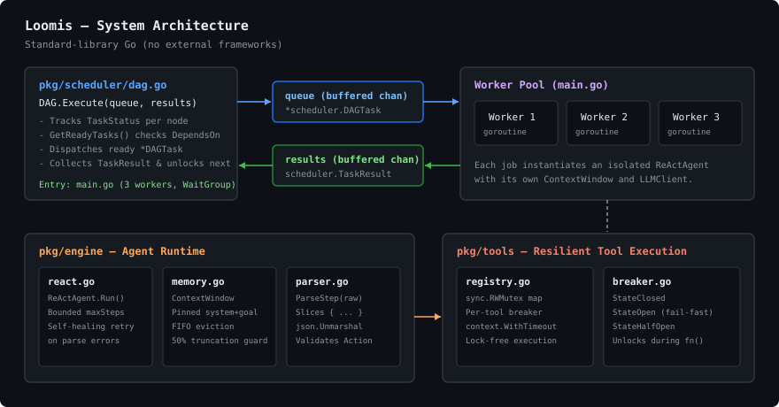
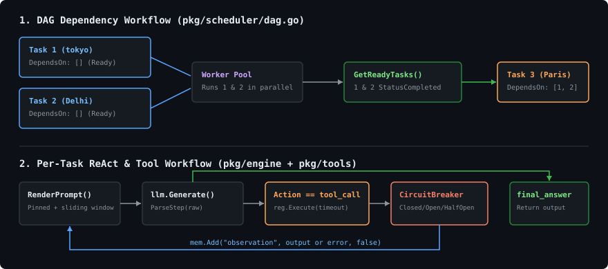

# Loomis

A concurrent agent orchestration engine written from scratch in Go using only the standard library.

Loomis schedules dependency-aware task graphs (DAGs) across a bounded worker pool, runs a multi-turn Reason + Act (ReAct) loop per task, manages token budgets with pinned sliding-window memory, and isolates failing tools behind per-tool circuit breakers.

## Architecture



## Workflows



## Package Breakdown

| Package / File | Responsibility |
| --- | --- |
| [`main.go`](main.go) | Sets up the tool registry, spawns 3 worker goroutines via `sync.WaitGroup`, builds a sample 3-node DAG, and coordinates shutdown (`close(queue)` + `wg.Wait()`). Includes `MockLLM` and an `OpenRouterClient` HTTP implementation. |
| [`pkg/scheduler/dag.go`](pkg/scheduler/dag.go) | Event-driven DAG scheduler (`DAGTask`, `TaskStatus`, `IsReadyToRun`, `GetReadyTasks`, `Execute`). Dispatches tasks with zero pending dependencies in parallel and unlocks downstream tasks as results arrive. |
| [`pkg/engine/react.go`](pkg/engine/react.go) | `ReActAgent.Run` state machine capped by `maxSteps`. Calls `LLMClient.Generate`, feeds parse errors back as self-healing observations, and routes `tool_call` actions to `tools.Registry`. |
| [`pkg/engine/memory.go`](pkg/engine/memory.go) | `ContextWindow` with `Pinned` retention for system instructions and the user goal, FIFO eviction of unpinned turns when exceeding `maxTokens`, and a 50% single-message truncation guard. |
| [`pkg/engine/parser.go`](pkg/engine/parser.go) | `ParseStep` extracts JSON between the first `{` and last `}`, unmarshals into `AgentStep`, and validates `Action` (`tool_call` or `final_answer`) and `ToolName`. |
| [`pkg/tools/registry.go`](pkg/tools/registry.go) | Thread-safe tool directory guarded by `sync.RWMutex` (`RLock` for lookups, `Lock` for registration). Wraps each call in `context.WithTimeout` and its own `CircuitBreaker`. |
| [`pkg/tools/breaker.go`](pkg/tools/breaker.go) | 3-state `CircuitBreaker` (`StateClosed`, `StateOpen`, `StateHalfOpen`). Releases its `sync.Mutex` before invoking `fn()` so slow network calls do not block other workers. |

## Key Design Decisions

- **Short mutex windows in `CircuitBreaker.Execute`:** `mu.Lock()` is held only to inspect/transition state and is explicitly unlocked before running `fn()`, preventing concurrent workers from serializing on slow I/O.
- **Pinned + sliding-window memory:** Blind FIFO eviction would drop the system prompt and user goal. Pinning those two entries ensures the agent retains its instructions and objective while older tool observations are evicted.
- **Pointer tasks in `queue`, value results in `results`:** `queue` passes `*scheduler.DAGTask` pointing to the scheduler's map entries (read-only by workers), while `results` passes `scheduler.TaskResult` by value to transfer ownership back to `DAG.Execute` without shared-memory races.
- **Self-healing JSON loop:** Malformed LLM outputs and tool errors are appended to `ContextWindow` as observations rather than crashing the worker, giving the model subsequent turns to correct its syntax or recover.

## Running

Requires Go 1.25+ (uses `sync.WaitGroup.Go` and `slices.Delete`).

```bash
go vet ./...
go run main.go
```
